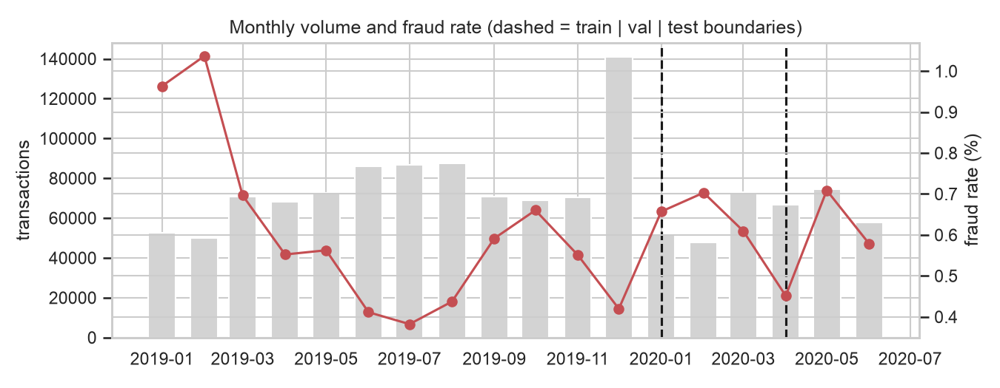
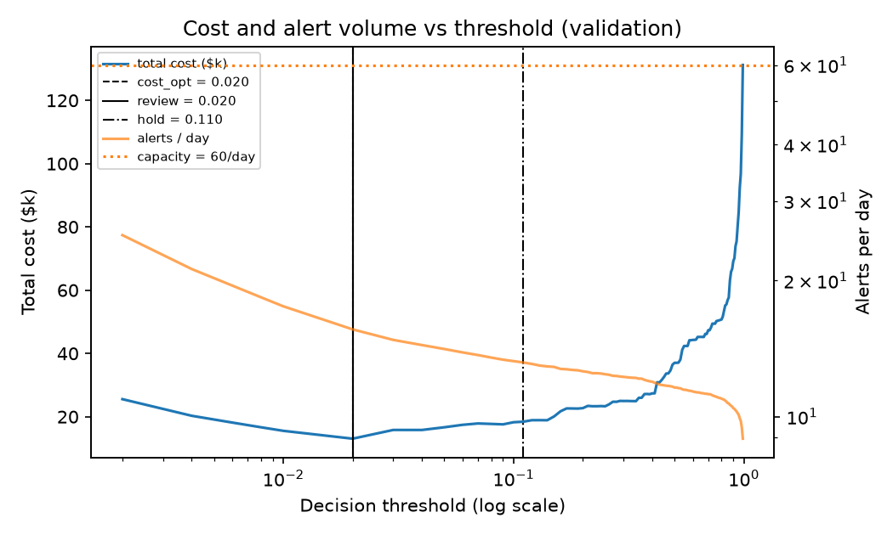
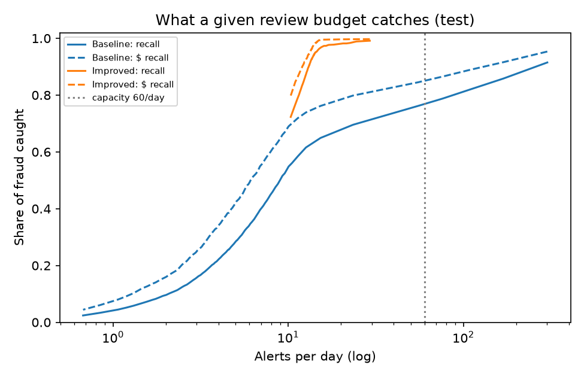
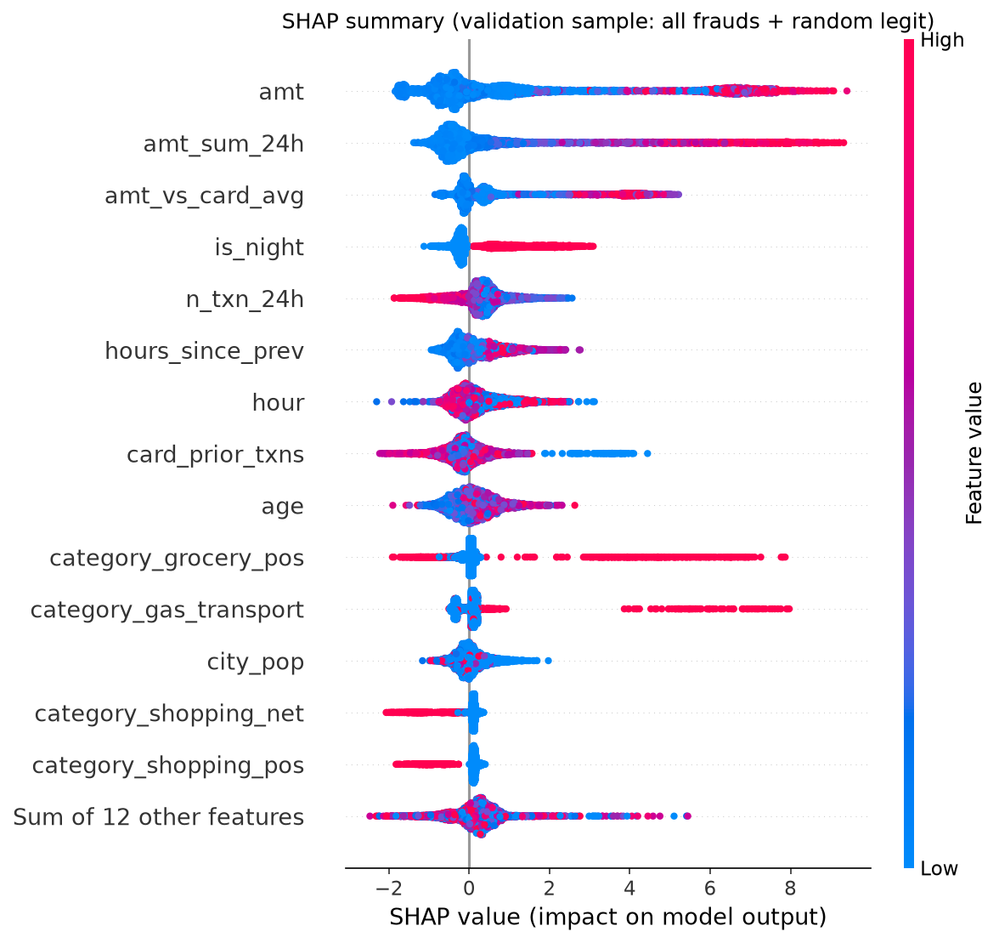

# Fraud / Transaction Risk Detection

> UneeQ Interns · Machine Learning Track · October 2026
> **Demo video:** [`demo/fraud_demo.mp4`](demo/fraud_demo.mp4) (30 s, the Streamlit app) · **Author:** Michael Danial

A fraud-risk scoring pipeline for card transactions that decides **which transactions a human should look at,
and in what order**. It never declines a payment on its own. Transactions are split into three tiers:
approve, analyst review, and hold-and-verify with the customer. The thresholds come from a per-transaction
cost model and the fraud team's daily review capacity.

**Headline result (untouched test period, Apr–Jun 2020, 199k transactions, 1,163 frauds):**

| Metric | Value |
|---|---|
| Alerts per day | **18**, against a capacity of 60 (0.75% of transactions) |
| Frauds caught | **97.8%** (95% CI 96.8–98.6%) |
| Fraud dollars caught | **99.6%** |
| Alerts that are real fraud | **76.7%** |
| Total cost | **$14k**, vs $643k with no screening and $153k for the logistic-regression baseline at the same capacity |

> **Read this first:** the data is simulated (Sparkov), and fraud in it is much easier to separate than in real life.
> The **process** (time split, past-only features, cost- and capacity-based thresholds, human-review tiers) is the
> deliverable. The numbers would be far lower on real transactions.

## 1. Business Problem
A card issuer reimburses customers for fraud, so every missed fraud costs **its own amount** plus handling fees.
Flagging is not free either: each alert costs analyst time, and holding a genuine customer's payment costs goodwill.
The fraud team can only review a fixed number of alerts per day. The model's job is to spend that review budget on
the transactions most likely to be fraud, weighted by how much money is at stake. **It supports decisions; it does
not make them.**

## 2. Dataset
- **Source:** [Credit Card Transactions Fraud Detection (Sparkov simulation)](https://www.kaggle.com/datasets/kartik2112/fraud-detection) on Kaggle. Check the licence on the dataset page before redistributing.
- **File used:** `fraudTrain.csv`
  - 1,296,675 transactions, 983 cards, 2019-01-01 to 2020-06-21
  - 7,506 frauds (**0.58%**, 1 in 173), which are **4.4% of all transaction dollars**
- **How to get it:** download the zip from Kaggle (login required), unzip, and put `fraudTrain.csv` in `data/raw/`.
  Data is gitignored. The first run builds a cached feature table in `data/processed/` (~15 s).
- **Columns dropped:** names, street, job, merchant name and transaction ID (PII or identifiers).
  `gender` is kept **only** for the fairness audit and is not a model input.

**What the EDA showed** (`notebooks/01_eda.ipynb`):
- **Bursts.** Fraud arrives in bursts: 762 of 983 cards (78%) are hit, with a median of 10 frauds within ~1.9 days.
- **Drift.** The monthly fraud rate swings between 0.38% and 1.04%.
- **Night.** ~85% of frauds happen 22:00–04:00.
- **Categories.** `shopping_net` (1.76% fraud rate, $1.7M of fraud), `misc_net` (1.45%) and `grocery_pos` (1.41%) dominate.
- **Card behaviour.** The median fraud is **5.2x** the card's usual amount (legit: 0.66x) and arrives 1.4h after the
  previous transaction (legit: 4.6h). Fraud shows up as a change in how a card is used.



## 3. Approach
```
fraudTrain.csv ─► clean (parse time, age at txn) ─► card-history features (past-only)
     ─► chronological split: train 2019 │ val Jan–Mar 2020 │ test Apr–Jun 2020
     ─► [1] model × imbalance comparison (fit train, score val)
     ─► [2] LightGBM random search (val PR-AUC; class weight as a hyperparameter)
     ─► [3] decision policy on val: $ cost curve + alert capacity ─► review / hold thresholds
     ─► [4] test evaluated once ─► memo, explanations, error + fairness analysis, analyst-queue demo
```

| Split | Period | Transactions | Frauds | Fraud rate |
|---|---|---|---|---|
| Train | 2019-01-01 – 2019-12-31 | 924,850 | 5,220 | 0.56% |
| Validation | 2020-01-01 – 2020-03-31 | 172,843 | 1,123 | 0.65% |
| Test | 2020-04-01 – 2020-06-21 | 198,982 | 1,163 | 0.58% |

**What changed from the churn project (and why):**

| Churn (Task 1) | Fraud (this task) | Why |
|---|---|---|
| Stratified random split | **Chronological split** | Fraud drifts and comes in bursts on one card; a random split puts parts of the same burst in both train and test. |
| Flat cost per error ($300 / $50) | **Per-transaction cost** (missed = amount + $20) | A missed $1,000 fraud is not the same as a missed $5 one. |
| Cost-optimal threshold | **Cost-optimal *within* analyst capacity**, plus a high-precision hold tier | Analysts can only review a fixed number of alerts per day; no automatic decisions. |
| 5-fold CV + 60-iteration search | Fit on train, score on later val; 15-iteration search | 1.3M rows; shuffled CV across time would leak the future. |
| Row-wise features in the pipeline | **Card-history features** (24h velocity, amount vs the card's usual, new category) | Fraud shows up as a change in a card's behaviour, not as a single odd value. |

**Card-history features** are built from each card's **earlier** transactions only. For example, the 24h window
excludes the current transaction. No labels are used, so they are exactly what an authorisation system would know at
payment time. A unit test checks that changing a *later* transaction never changes an earlier transaction's features.

## 4. Results

### Model and imbalance comparison (validation)
| Model | PR-AUC | ROC-AUC | Recall within capacity | $-recall within capacity |
|---|---|---|---|---|
| LightGBM + SMOTE (10%) | 0.986 | 0.9999 | 0.980 | 0.992 |
| LightGBM | 0.985 | 0.9999 | 0.978 | 0.989 |
| LightGBM + √ class weight | 0.982 | 0.9998 | 0.985 | 0.993 |
| LightGBM + full class weight | 0.978 | 0.9997 | 0.961 | 0.990 |
| Logistic Regression (baseline) | 0.581 | 0.970 | 0.720 | 0.826 |
| Logistic Regression + class weight | 0.495 | 0.990 | 0.898 | 0.974 |
| **Tuned LightGBM (final, √ class weight)** | **0.986** | | | |

**How to read this:**
- **ROC-AUC hides the gap.** The baseline scores 0.97 ROC-AUC but only 0.58 PR-AUC. At 0.6% fraud, ROC-AUC flatters
  any model, which is why it isn't used to choose.
- **Imbalance handling barely matters here.** Every LightGBM variant is within 0.01 PR-AUC.
- **Tuning didn't add anything.** The best of 15 random configs (0.9858) is level with the defaults (0.985) and
  SMOTE (0.986); differences of 0.001 are noise. The tuned model is kept because it needs no synthetic data.
  On this dataset the search is mostly wasted time, so `N_TUNE_ITER` can safely be lowered.
- **The baseline is linear and can't use the patterns.** Fraud depends on combinations, such as night + online
  shopping + amount far above the card's usual, which logistic regression cannot express.

### Threshold comparison (test, evaluated once)
| Policy | Threshold | Alerts/day | Precision | Recall | $-Recall | Fraud $ missed | Total cost |
|---|---|---|---|---|---|---|---|
| No model (approve everything) | – | 0 | – | 0% | 0% | $619,630 | $642,890 |
| Baseline @0.5 | 0.50 | 4.5 | 0.802 | 0.254 | 0.384 | $381,425 | $401,355 |
| Baseline @review (capacity) | 0.02 | 23.5 | 0.423 | 0.696 | 0.798 | $124,894 | $152,594 |
| Improved @0.5 | 0.50 | 13.7 | 0.968 | 0.930 | 0.967 | $20,631 | $28,201 |
| **Improved @review (chosen)** | **0.02** | **18.2** | 0.767 | **0.978** | **0.996** | **$2,670** | **$14,065** |
| Improved @hold (high precision) | 0.11 | 15.0 | 0.917 | 0.962 | 0.993 | $4,329 | $12,319 |

- **0.5 is the wrong default.** The usual 0.5 threshold costs twice as much as the chosen one ($28k vs $14k):
  missing a fraud costs far more than reviewing a false alarm.
- **Capacity isn't the limit.** The cheapest threshold needs only 18 alerts/day, so the 60/day budget has slack.
  `reports/alert_budget_test.csv` shows the trade-off: at 10 alerts/day the model catches 70% of frauds (77% of
  dollars); at 20/day, 98% (99.6%).
- **The choice is robust.** On validation, the chosen threshold stays at 0.02 for every scenario tested: chargeback
  fee $0–50, friction $0–30, capacity 30 to unlimited (`reports/cost_sensitivity_val.csv`).




### Decision tiers (test)
| Tier | Action | Transactions | Frauds | Fraud rate | Share of fraud $ |
|---|---|---|---|---|---|
| approve | Goes through, no human action | 197,499 (99.25%) | 26 | 0.01% | 0.4% |
| review | Goes through; an analyst checks it within the SLA | 263 (0.13%) | 18 | 6.8% | 0.3% |
| hold_verify | Held until the customer confirms (OTP / call); an analyst confirms the outcome | 1,220 (0.61%) | 1,119 | **91.7%** | 99.3% |

## 5. Task-Specific Criteria

### Imbalanced data
- **Approaches compared:** no weighting, √-ratio and full-ratio class weights, and SMOTE at 10% (results in §4).
  Class weight is also a hyperparameter in the search.
- **Metrics:** PR-AUC, recall and **$-recall at the alert budget**. Accuracy is meaningless here: approving
  everything would score 99.4%.

### Metrics and threshold comparison
- **Thresholds compared** (§4): 0.5, cost-optimal (unlimited analysts), capacity-constrained review, and
  high-precision hold.
- **How they are chosen:** all thresholds are picked on validation. Test is touched once.
- **Uncertainty:** 95% bootstrap intervals are in `reports/test_uncertainty.json`.

### Cost / impact
Costs are in `src/config.py` and are **assumptions, not measured values**:

| Item | Assumed cost |
|---|---|
| Missed fraud | its own amount + $20 chargeback handling |
| Each alert | $5 of analyst time |
| Each false alarm | an extra $10 of customer friction |

Against approving everything, the chosen policy saves **$629k over 82 days** (~$231k per 30 days) on test.

### Model explanation
- **Global (SHAP on all validation frauds + random legit rows):** amount, 24h spend on the card, merchant category
  and amount-vs-usual lead. **7 of the top 9 features are engineered card-history or time features.**
  See `shap_summary.png` and `reports/feature_importance.csv`.
- **Per alert:** plain-English reason codes, used in the demo and in `reports/reason_code_examples.csv`. Examples:
  - *"$4,017 spent on this card in the previous 24h · Amount $796.74 · Amount is 11.5x this card's usual spend"* (caught fraud)
  - *"Amount $4,185.61 · Amount is 86.6x this card's usual spend"* (a false alarm: a genuine large purchase, which is
    exactly what an analyst or a quick customer check resolves)



### Human-review framing
- **No automatic declines.** The model never declines a payment. It ranks and routes transactions; people decide.
- **Hold tier is for near-certain cases only.** It requires ≥90% precision on validation and reached 91.7% on test,
  because holding a genuine payment is the costliest false alarm.
- **Analysts see the reasons.** The analyst queue (`streamlit run app.py`) shows each alert's score, tier and top
  reasons, so reviewers can challenge the model rather than rubber-stamp it.

### Error analysis and fairness (validation, review threshold)
- **What gets missed.** 14 frauds ($2,577) were missed out of 1,123. The weakest segments are `food_dining`
  (86% recall), `misc_pos` (92%), $20–100 amounts (93%) and daytime fraud (93%, vs 99.7% at night).
  - Missed frauds average $184 and 2.6x the card's usual amount, and 21% happen at night.
  - Caught frauds average $539 and 7.6x, and 86% happen at night.
  - **The model misses fraud that looks like ordinary spending.**
- **Who gets false alarms.** False-alarm rate (share of genuine transactions flagged):
  - women 0.22% vs men 0.13%, although gender is not an input
  - by age, from 0.07% (60–74) to 0.24% (30–44)
  - recall is similar across all groups (97.8–99.7%)

  The gender gap comes through correlated spending behaviour and is flagged for monitoring.
  See `reports/fairness_audit.csv`.

### Risk threshold memo
[`reports/risk_threshold_memo.md`](reports/risk_threshold_memo.md) is the decision document: recommendation, tiers,
threshold comparison, cost assumptions, sensitivity, review budget, risks and guardrails. It is generated from the
results by `python -m src.memo`, so its numbers always match the latest run.

## 6. Limitations & Next Steps
- **Simulated data is too easy.** PR-AUC of 0.98 is not realistic. Sparkov fraud follows strong, regular patterns
  (night, online categories, large bursts). Real fraud is noisier and adapts to the detector.
- **Labels arrive late.** In reality chargebacks take weeks, so the newest data is partly unlabelled. Here labels are
  assumed immediate.
- **Same cards in train and test.** The split is by time, not by card, so test cards have history in train, as they
  would in production. Brand-new cards are a separate, harder problem.
- **Not retrained on train + val.** The final model is trained on 2019 only, so the thresholds picked on val match the
  model exactly. Production would retrain on all labelled data and re-pick thresholds monthly.
- **Scores are not calibrated probabilities** (class-weighted model). They are used as a ranking, with thresholds
  picked empirically. See `calibration.png`.
- **Cost figures are assumptions.** The sensitivity table shows the decision holds across a wide range, but real
  costs should replace them.
- **Next steps:** test on real or harder data (e.g. IEEE-CIS); per-day capacity instead of per-period ranking;
  merchant-level risk features (target-encoded within time folds); drift monitoring on score distribution and
  reviewed-alert precision.

## 7. How to Run
```bash
uv venv --python 3.12
source .venv/bin/activate
uv pip install -r requirements.txt
# put fraudTrain.csv in data/raw/
python -m src.train        # ~6 min on an M-series MacBook (6 model variants + 15 tuning fits on 925k rows)
python -m src.explain      # SHAP, reason codes, error analysis, fairness audit (~30 s)
python -m src.memo         # writes reports/risk_threshold_memo.md
python -m src.eda          # small EDA tables for the app's "The data" page
pytest -q                  # pipeline tests (leakage guards, split, cost logic) + app smoke tests
streamlit run app.py       # the app at http://localhost:8501
```
The app has five pages: **Review queue** (one test day ranked by risk, each alert with its reasons and an optional
hindsight view), **Thresholds** (move the threshold and see alerts, catch rate and cost change), **Results**,
**Mistakes** (what it misses, false alarms, fairness) and **The data**.

Speed knobs live in `src/config.py`: `N_TUNE_ITER` (5 is enough on this data) and `SHAP_SAMPLE`.

## 8. Project Structure
```
├── data/            # raw/ (fraudTrain.csv) and processed/ (feature cache, scored test set), gitignored
├── notebooks/       # 01_eda.ipynb
├── src/
│   ├── config.py    # split dates, cost assumptions, capacity, tuning budget
│   ├── data.py      # load, clean, chronological split
│   ├── features.py  # card-history features (past-only) + sklearn preprocessor
│   ├── train.py     # comparison, tuning, decision policy, test evaluation
│   ├── evaluate.py  # generic metrics (from Task 1) + $ cost curve, capacity thresholds, tiers
│   ├── explain.py   # SHAP, reason codes, error analysis, fairness audit
│   ├── memo.py      # generates the risk threshold memo from results
│   └── eda.py       # small EDA tables for the app
├── tests/           # pytest: leakage guards, decision logic, app smoke tests
├── app_lib/         # app design system + data loading
├── app_pages/       # the five Streamlit pages
├── demo/            # fraud_demo.mp4 + the scripts that recorded and edited it
├── models/          # saved models + meta.json, gitignored
├── reports/         # memo, result tables, figures
└── app.py           # Streamlit entry point (navigation)
```
